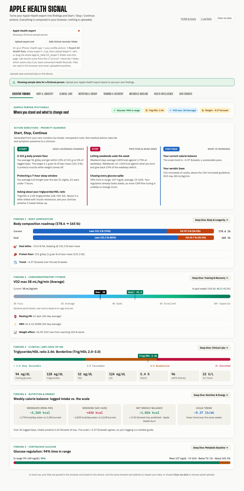

# Apple Health Signal

Turn your Apple Health export into plain-language findings and a **Start / Stop / Continue** action list, computed entirely in your browser.



## What it does

Upload `export.xml` from the iPhone Health app (and, optionally, the `clinical-records/` folder) and get:

- **Action directives**: Start, Stop, and Continue items built from your own numbers, e.g. a protein floor based on your lean mass, weekend vs. weekday calorie balance, strength and cardio volume, sleep, resting heart rate trend, and lab follow-ups. A rule only fires when its data exists.
- **Body composition**: weight trend, lean and fat mass, and a fat-loss roadmap to your goal weight that keeps lean mass constant.
- **Cardiorespiratory fitness**: VO2 max with general reference bands, plus how it scales at your goal weight; resting HR and HRV.
- **Nutrition and energy**: food logs from any app that writes to Apple Health (MyFitnessPal, Lose It!, Cronometer, …) compared with the active and basal energy Apple Health recorded, then checked against your actual scale trend.
- **Continuous glucose**: time in range, variability, sensor gaps, overnight lows, morning rise, meal and workout responses, and an hour-by-day heatmap, for any CGM that writes to Apple Health.
- **Clinical labs**: lipid panel, triglyceride/HDL ratio, fasting glucose, HbA1c, liver and kidney markers, and history, from Health Records FHIR files.
- **Training and recovery**: full workout history by discipline, fasted vs. fed sessions, and heart rate during workouts.

A fictional sample person loads on first visit so you can explore before uploading anything.

## Privacy

Your files never leave your device. The page is a single static HTML file with no backend, analytics, or third-party scripts (only Google Fonts). Parsed data is saved in your browser's IndexedDB so it survives a refresh; **Clear my data** removes it.

## Use it

1. On your iPhone: **Health** app → your profile picture → **Export All Health Data**. AirDrop or save the zip to your computer and unzip it.
2. Open the app (see below) and upload `apple_health_export/export.xml`, or drag the whole `apple_health_export` folder onto the page.
3. Optional: add the `clinical-records/` folder for lab results (only present if you have connected Health Records).
4. Open **Profile & Goals** to set your height, goal weight, and eating window.

Large exports are fine: a 3.6 GB export parses in about 20 seconds because the file is streamed line by line.

No export handy? Try `sample/apple_health_export/`. It contains a fictional person in the real export format.

## Run locally

No build step and no dependencies.

```bash
git clone https://github.com/apratsunrthd/apple-health-signal.git
cd apple-health-signal
python3 -m http.server 8000
# open http://localhost:8000
```

Opening `index.html` directly also works in most browsers. A local server is more reliable for saved data.

## Development

Requires Node 20+ and Python 3.

```bash
python3 scripts/check-inline-js.py     # syntax-check the inline script
python3 scripts/run-tests.py           # node --test tests/*.test.mjs (TZ pinned)
node scripts/make-sample-export.mjs    # regenerate sample/apple_health_export from the in-app sample
```

## Project layout

```
index.html                  the whole app: markup, CSS, and one inline script
sample/apple_health_export  fictional export.xml + clinical-records/ for trying the upload path
scripts/                    syntax check, test runner, sample generator
tests/                      node:test suites with a minimal DOM/IndexedDB harness
```

See [ARCHITECTURE.md](ARCHITECTURE.md) for how the parser, analytics, and rules engine fit together.

## Contributing

Issues and pull requests are welcome. Keep the app a single dependency-free file, add a test for any new parser or rule, and run both scripts above before opening a PR. By contributing you agree your contribution is licensed under the project license.

## Disclaimer

This is an educational tool, not a medical device, and nothing it shows is medical advice. Discuss lab results, symptoms, and changes to diet or training with a qualified clinician.

## License

[PolyForm Noncommercial 1.0.0](LICENSE.md). Free for personal, research, educational, and nonprofit use. **Commercial use needs a paid license**; see [COMMERCIAL.md](COMMERCIAL.md).
